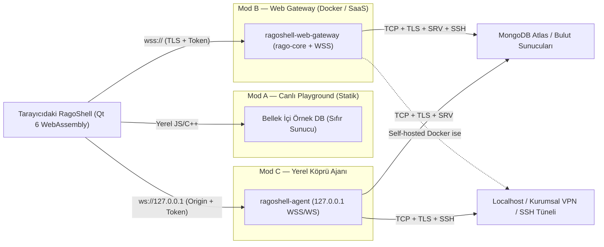

# RagoShell — Tarayıcı Sürümü (Qt 6 for WebAssembly) Mimari ve Yol Haritası

Bu doküman; RagoShell'in **Qt 6 for WebAssembly (WASM)** kullanılarak web tarayıcılarında çalıştırılmasına yönelik **lisans uyumluluğunu**, **teknik mimariyi**, **MongoDB/SSH bağlantı modellerini**, **güvenlik gereksinimlerini** ve **aşamalı yapılacaklar listesini** tanımlar.

İlgili dokümanlar: [`docs/Platforms.md`](./Platforms.md), [`docs/Shell.md`](./Shell.md), [`THIRD-PARTY-NOTICES.txt`](../THIRD-PARTY-NOTICES.txt).

---

## 1. Lisans ve Hukuki Uyumluluk (Qt 6 WebAssembly + GPLv3)

**Sonuç: RagoShell ile Qt 6 Open Source / Community Edition arasında hiçbir lisans çakışması yoktur (%100 uyumludur).**

- **Qt for WebAssembly Lisans Modeli:** Masaüstü ve mobilde pek çok Qt modülü `LGPLv3` altında sunulurken, **Qt for WebAssembly** platform entegrasyonu açık kaynak sürümde **yalnızca `GNU GPLv3`** (veya ticari lisans) altında dağıtılır. Bunun nedeni Emscripten derlemesinde uygulama kodu ile Qt kütüphanelerinin tarayıcıya indirilen tek bir `.wasm` ikili dosyasında statik olarak birleşmesidir.
- **Neden RagoShell İçin Engel Değildir?** Kapalı kaynaklı ticari yazılımlar için bu durum ticari Qt lisansı satın almayı gerektirir; ancak RagoShell zaten **`GNU GPLv3`** lisanslı bir özgür yazılımdır ([`COPYRIGHT`](../COPYRIGHT), [`THIRD-PARTY-NOTICES.txt`](../THIRD-PARTY-NOTICES.txt)). İçerdiği tüm üçüncü taraf bileşenler (`QScintilla` — `GPLv3`, `mongocxx`/`libmongoc` — `Apache-2.0`, `OpenSSL 3` — `Apache-2.0`, `libssh2` — `BSD-3-Clause`) `GPLv3` ile uyumludur.
- **Dağıtım Yükümlülüğü (`GPLv3` Madde 6):** Tarayıcıya `.wasm` ve `.js` dosyalarını sunmak ikili dağıtım (*conveying*) sayılır. Bu nedenle:
  1. Tarayıcıda çalışan istemci kodunun ve derleme betiklerinin GitHub deposunda `GPLv3` altında açık tutulması,
  2. Uygulama içindeki `Yardım → Açık Kaynak Lisansları` (`LicensesDialog.qml`) ekranından tam kaynak kodu deposuna bağlantı verilmesi yeterlidir.
- **Arka Uç (Gateway / SaaS) Ayrımı:** Standart `GPLv3` (`AGPLv3` değildir), tarayıcıdaki istemcinin ağ üzerinden (`HTTPS` / `wss://`) haberleştiği **ayrı bir sunucu yazılımının** kaynak kodunu açmayı zorunlu tutmaz. İstemci açık kaynak kalırken, bulut bağlantı geçidi ve SaaS servisleri kapalı kaynak olarak işletilebilir.

---

## 2. Mevcut Kod Tabanının WebAssembly Uyumluluk Matrisi

| Katman / Bileşen | Mevcut Yapı | WebAssembly Durumu ve Gerekli Uyarlama |
|---|---|---|
| **QML Arayüzü** (`src/ragoshell-app/qml/`) | `QtQuick`, `QtQuickControls2`, duyarlı düzen | **Doğrudan uyumlu.** Tarayıcıda WebGL2 Canvas üzerinde aynı görünüm ve `Compact` / `Touch` yoğunluklarıyla çalışır. |
| **JavaScript Kabuğu** (`JsShellBackend.cpp`) | Yerleşik `QJSEngine` (Node.js yok) | **Büyük avantaj — doğrudan uyumlu.** Harici süreç gerektirmediği için `.wasm` içinde doğal olarak çalışır. |
| **Kod Editörü** (`QScintilla` / `ScintillaQuick`) | `QtWidgets` + özel QML sarmalayıcı | **Uyumlu.** Qt WASM `QtWidgets` modülünü destekler; tarayıcı panosu (`navigator.clipboard`) ve mobil/masaüstü klavye olayları doğrulanmalıdır. |
| **İş Parçacıkları** (`MongoWorker`, `EventBus`) | Arka plan `QThread` + kuyruklu olaylar | `wasm_multithread` kitinde (`SharedArrayBuffer` + `COOP`/`COEP` HTTP başlıklarıyla) mevcut `QThread` yapısı korunur. |
| **Ayarlar ve Dosyalar** (`AppPaths`, `SettingsManager`) | Yerel disk (`~/.ragoshell/`) | Emscripten **`IDBFS` (`IndexedDB`)** bağlanarak ayarlar tarayıcıda kalıcı hale getirilir; içe/dışa aktarmada `QFileDialog::getOpenFileContent` / `saveFileContent` kullanılır. |
| **Anahtar Saklama** (`KeyStore`) | İşletim sistemi Keychain / Credential Manager | `KeyStore_wasm.cpp` yazılır: varsayılan olarak oturum belleği, kalıcı modda ise Web Crypto API veya kullanıcı ana parolası (`AES-256-GCM`) kullanılır. |
| **Ağ ve Sürücüler** (`libmongoc`, `libssh2`, `OpenSSL`) | Ham POSIX TCP soketleri (`27017`, `22`) | **Doğrudan çalışmaz.** Tarayıcı kum havuzu ham TCP soketi açmaya izin vermez; aşağıdaki **Bölüm 3** mimarilerinden biriyle soyutlanmalıdır. |

---

## 3. Önerilen Bağlantı Mimarileri

Web tarayıcıları güvenlik gereği yalnızca `HTTPS`, `WebSocket (wss://)` ve `WebTransport` protokollerine izin verir; MongoDB Wire Protocol (`OP_MSG`) veya SSH el sıkışması doğrudan tarayıcıdan yapılamaz. Bu nedenle üç tamamlayıcı çalışma modu önerilir:

### Mod A — Kurulumsuz "Canlı Playground" (`ragoshell.com.tr/demo`)
- **Amaç:** Pazarlama, kişisel marka bilinirliği ve ürün tanıtımı. Ziyaretçi hiçbir paket indirmeden 3 saniye içinde gerçek RagoShell arayüzünü tarayıcıda dener.
- **Çalışma Şekli:** `libmongoc` ve `libssh2` derlemeye dahil edilmez (`RAGO_WASM_DEMO=ON`). Örnek koleksiyonlar (`catalog.products`, `orders`, `users`) bellek içi (in-memory) sahte bir veri sağlayıcısından sunulur; otomatik tamamlama, ağaç/tablo/JSON görünümleri ve şema analizi birebir çalışır.
- **Maliyet ve Barındırma:** %100 statik dosyalardan (`.html`, `.js`, `.wasm`) oluşur; Cloudflare Pages veya GitHub Pages üzerinde **sıfır sunucu maliyeti ve sıfır güvenlik riskiyle** yayınlanır.

### Mod B — `ragoshell-web-gateway` (Self-Hosted Docker & Bulut SaaS)
- **Amaç:** Kurulumsuz tam sürüm tarayıcı kullanımı (DbGate / CloudBeaver modeli).
- **Neden Ham TCP Tüneli Yerine Uygulama Seviyesi Gateway?**
  1. `libmongoc`, `OpenSSL` ve `libssh2` tarayıcıya indirilmez; `.wasm` boyutu yarı yarıya küçülür (Brotli ile ~8–12 MB).
  2. `mongodb+srv://` (Atlas DNS SRV çözümlemesi), `SCRAM-SHA-256`, `X.509`, `GSSAPI` ve **SSH tünelleri** sunucu tarafında [`rago-core`](../src/ragoshell/CMakeLists.txt) üzerinde %100 doğal C++ hızında çalışır.
  3. Mevcut [`ragoshell-mcp`](../src/ragoshell-mcp/) JSON-RPC mimarisiyle aynı tasarım desenini paylaşır; tarayıcı yalnızca EJSON/JSON-RPC mesajları (`openConnection`, `executeScript`, `listCollections` vb.) alıp gönderir.
- **İki Dağıtım Seçeneği:**
  - **Self-Hosted Docker (`docker run -p 8080:8080 ragoshell/web`):** Şirketlerin kendi iç ağlarına/VPN'lerine veya geliştiricinin kendi makinesine kurduğu tek konteynerlik pakettir (statik WASM arayüzü + Gateway bir arada).
  - **Yönetilen Bulut (`app.ragoshell.com`):** Kullanıcının doğrudan tarayıcıdan girip MongoDB Atlas veya genel IP'li sunucularına bağlandığı SaaS katmanıdır (isteğe bağlı bulut hizmetleriyle birleştirilebilir).

### Mod C — Yerel Köprü Ajanı (`ragoshell-agent`)
- **Amaç:** Buluttaki `app.ragoshell.com` arayüzünü kullanan bir geliştiricinin kendi bilgisayarındaki `localhost:27017` veya şirket VPN'indeki veritabanlarına erişebilmesi (Postman / Hoppscotch Desktop Agent modeli).
- **Çalışma Şekli:** Kullanıcının bilgisayarında arka planda çalışan küçük (~5–10 MB), arayüzsüz `rago-core` ikilisidir. Yalnızca `127.0.0.1` üzerinde dinler; veritabanı parolaları, SSH özel anahtarları ve sorgu trafiği bulut sunucusuna hiç uğramadan doğrudan kullanıcının makinesinden hedef MongoDB'ye çıkar.

---

## 4. Zorunlu Güvenlik Kontrolleri

1. **Bulut Gateway İçin SSRF ve DNS Rebinding Koruması:**
   - Genel bulut sürümünde (`app.ragoshell.com.tr`), kullanıcının girdiği hedef MongoDB ve SSH adresleri hem ilk bağlantıda hem de DNS çözümlemesi **sonrasında** doğrulanmalı; loopback (`127.0.0.0/8`, `::1`), özel ağlar (`10.0.0.0/8`, `172.16.0.0/12`, `192.168.0.0/16`), link-local / bulut metadata servisleri (`169.254.0.0/16`, `fe80::/10`) kesin olarak reddedilmelidir. *(Self-hosted Docker kipinde bu kural yapılandırılabilir bir ortam değişkeniyle açılabilir.)*
2. **Yerel Ajan (`ragoshell-agent`) İçin CSWSH Koruması:**
   - Herhangi bir kötü niyetli web sayfasının `ws://127.0.0.1` üzerinden yerel ajana komut göndermesini önlemek için sıkı `Origin` beyaz listesi (`https://app.ragoshell.com.tr`) **ve** kullanıcı onaylı kriptografik eşleştirme jetonu (*pairing token*) zorunlu olmalıdır.
3. **Tarayıcıda Kimlik Bilgisi Güvenliği:**
   - Genel/paylaşımlı bilgisayar riskine karşı tarayıcı sürümünde bağlantı parolaları ve SSH anahtarları varsayılan olarak **yalnızca sekme belleğinde** tutulmalı; kalıcı kayıt istenirse kullanıcı tarafından belirlenen bir ana parola (`Argon2id`/`PBKDF2` + `AES-256-GCM`) ile şifrelenmelidir.
4. **HTTP Güvenlik Başlıkları:**
   - `wasm_multithread` için `Cross-Origin-Opener-Policy: same-origin` ve `Cross-Origin-Embedder-Policy: require-corp`, ayrıca sıkı `Content-Security-Policy` (`script-src 'self' 'wasm-unsafe-eval'`) tanımlanmalıdır.

---

## 5. Yapılacaklar Listesi (Uygulama Yol Haritası)

### Faz 1 — CMake & Derleme Altyapısı + Canlı Playground (MVP)
- [x] **1.1.** `cmake/RagoShellPlatform.cmake` ve `CMakeLists.txt` içine `SYSTEM_WASM` (`CMAKE_SYSTEM_NAME STREQUAL "Emscripten"`) bayrağının eklenmesi; masaüstü araçlarının (`ragoshell-mcp`, `rago_unit_tests`) `SYSTEM_MOBILE` gibi `SYSTEM_WASM` hedefinde de devre dışı bırakılması. — 2026-11-03 (`SYSTEM_WASM` `SYSTEM_MOBILE` davranışını da tetikliyor; wasm derlemesi araçları üretmiyor)
- [x] **1.2.** `CMakePresets.json` içine Emscripten SDK + Qt 6.12 WebAssembly (`wasm_singlethread` ve `wasm_multithread`) yapılandırma preset'lerinin eklenmesi. — 2026-11-03 (`wasm-single` + `wasm-multi`; vcpkg chainload, `WasmBuildReport.md` §6)
- [x] **1.3.** Doğrudan `libmongoc` / `libssh2` bağlamadan arayüzün derlenebilmesi için `MongoWorker` arkasına soyut bir bağlantı arayüzü (`IMongoTransport`: yerel `NativeMongoTransport`, demo için `InMemoryDemoTransport`, ağ için `WebSocketGatewayTransport`) çıkarılması. — 2026-11-03 (`core/transport/` + `MongoClient`/`MongoWorker` transport dalı; docs/TransportSeam.md)
- [x] **1.4.** Örnek veri kümesiyle (`catalog.products`, `customers`, `orders`) çalışan **Canlı Playground** derlemesinin üretilmesi, Brotli (`.wasm.br`) sıkıştırmasının ayarlanması ve `LicensesDialog.qml` kaynak kodu bağlantısının doğrulanması. — 2026-11-03 (emsdk 5.0.5 + vcpkg `wasm32-emscripten` ile tam derleme: `.wasm` 52 MB, `.wasm.br` 15 MB post-build adımı; `LicensesDialog` "Source Code" → `Brand.sourceRepoUrl`; WASM'de `catalog` demo bağlantısı `transportKind=memory` ile tohumlanıyor)

### Faz 2 — Tarayıcı Depolama, Pano ve Dosya Entegrasyonu
- [x] **2.1.** `AppPaths.cpp` içinde `Q_OS_WASM` için `/persist/.ragoshell` yolunun tanımlanması ve Emscripten `IDBFS` senkronizasyonunun (`SettingsManager::save` sonrası `FS.syncfs`) bağlanması. — 2026-11-03 (`persist-pre.js` mount + run-dependency populate; `requestPersistSync()` save/import/key-file sonrası)
- [x] **2.2.** `KeyStore_wasm.cpp` modülünün yazılması (varsayılan oturum belleği + isteğe bağlı parola tabanlı `AES-256-GCM` şifreleme). — 2026-11-03 (`SessionKeyStore` + `PassphraseFileKeyStore` (Argon2id+GCM, canary doğrulamalı), `RAGOSHELL_KEYSTORE_PASS` ile; 9 test)
- [x] **2.3.** `QmlBackendUtils.cpp` içindeki dosya okuma/kaydetme akışlarının (`ImportExportDialog`, `.js` betik açma/kaydetme, TLS sertifika seçimi) `Q_OS_WASM` üzerinde `QFileDialog::getOpenFileContent` ve `QFileDialog::saveFileContent` ile çalışacak şekilde uyarlanması. — 2026-11-03 (open: Qt wasm FileDialog→MEMFS yolu hazır; save: `Backend.saveFileAs`/`downloadFile` köprüleri + script-save ve export-download dalları)
- [~] **2.4.** Chrome, Safari ve Firefox üzerinde `ScintillaQuick` klavye kısayollarının (`Cmd`/`Ctrl+C`, `V`, `Enter`), Türkçe karakter girişinin ve tam ekran/yeniden boyutlandırma davranışının test edilmesi. — 2026-11-03 `(insan)` tarayıcı matrisi; hazır: `docs/WebStorage.md` (persist/pre-js, canary'li passfile, downloadFile akışı)

### Faz 3 — `ragoshell-web-gateway` ve Self-Hosted Docker Paketi
- [x] **3.1.** `src/ragoshell-web-gateway/` altında `rago-core` kullanan, oturum doğrulamalı WebSocket (`wss://`) + EJSON servisinin geliştirilmesi. — 2026-11-03 tek port `QAbstractHttpServer` (`addWebSocketUpgradeVerifier` + `GatewaySession`); TLS sonlandırma reverse proxy'de (`docs/WebGateway.md` §3)
- [x] **3.2.** İstemci tarafında `WebSocketGatewayTransport` (`QWebSocket`) sınıfının yazılarak `ServerTreeModel` olaylarının ağ üzerinden uçtan uca bağlanması. — 2026-11-03 (8.3'te tamamlandı, gateway'e yeniden kullanıldı). **Düzeltme 2026-11-04 (8.6 incelemesi M2):** `ShellController` ve `ServerMonitorController` sekonder worker'ları `IMongoTransport`'u atlar ve ham `mongocxx::client` açar — shell/monitor sekmeleri transport'lu bağlantılarda istemci tarafında reddedilir; transport-rout'lu shell gelecek iş.
- [x] **3.3.** SSRF / özel IP filtrelemesi, oturum zaman aşımı, eşzamanlı bağlantı sınırı ve istek boyutu limitlerinin birim testleriyle (`rago_unit_tests`) doğrulanması. — 2026-11-03 `EgressPolicy` + 9 test; oturum/limits testleri 8.3'te
- [x] **3.4.** Statik `.wasm` arayüzü ile `ragoshell-web-gateway` ikilisini tek imajda birleştiren `Dockerfile` (`ragoshell/web`) ve `COOP`/`COEP`/`CSP` başlık yapılandırmasının hazırlanması. — 2026-11-03 `src/ragoshell-web-gateway/docker/Dockerfile` (multi-stage, aqt 3.3.0/Qt 6.12 + pin'li vcpkg, uid 10001) + güvenlik başlıkları `main.cpp`

### Faz 4 — `ragoshell-agent` (Yerel Köprü) ve Bulut SaaS Yayını
- [x] **4.1.** Windows, macOS ve Linux için `127.0.0.1` üzerinde çalışan, `Origin` + eşleştirme jetonu korumalı `ragoshell-agent` ikilisinin üretilmesi. — 2026-11-03 `src/ragoshell-agent/` (Qt taşınabilir hedef; Origin+Host çift kontrolü, 0600 token dosyası, 8 oturum/1 MiB/30 sn hello/30 dk idle limitleri) — `docs/LocalAgent.md`
- [x] **4.2.** Tarayıcı arayüzündeki Bağlantı Yöneticisi'ne **Bağlantı Kanalı** seçiminin (*Bulut Gateway* / *Yerel Ajan (`localhost`)* / *Özel Self-Hosted Gateway URL*) eklenmesi. — 2026-11-03 `ConnectionDialog.qml` channel combo (Demo / Local Agent / Custom Gateway), `transportKind`+`transportTokenEncrypted` — wasm-only görünür
- [x] **4.3.** `app.ragoshell.com` bulut dağıtımının yapılması ve isteğe bağlı bulut hizmetlerinin hesap altyapısıyla birleştirilmesi.
